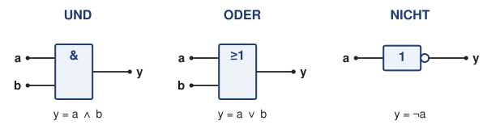
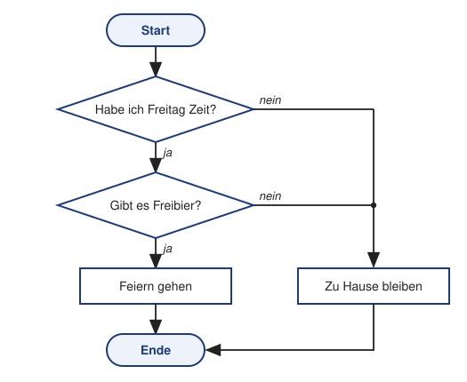

# Übung 00 – Logik im Alltag: Vom Satz zur booleschen Funktion

> **Info 1 · Übung 00** — Aufgabe: Logik im Alltag · Lösung: [Logik im Alltag](../Lösungen/00_Logik_im_Alltag_Lösung.md)

---

Ein Mikrocontroller kennt kein „Vielleicht“. Für ihn gibt es nur **1** (ja, wahr, an) und **0** (nein, falsch, aus). Trotzdem trifft er ziemlich clevere Entscheidungen, indem er einfache Ja/Nein-Bedingungen geschickt miteinander verknüpft.

Genau das machst du jeden Tag auch. In dieser Übung übersetzen wir ganz normale Sätze in **boolesche Funktionen** (benannt nach dem Mathematiker George Boole). Das sind Funktionen, deren Ein- und Ausgänge nur 0 oder 1 sein können. Sie sind die Grundlage für alles, was in den nächsten Wochen kommt: Schaltungen (Übung 01), Programmablaufpläne (Übung 04) und `if`-Abfragen in C++.

---

## Teil A – So geht's: Vom Satz zur Funktion

Unser Beispiel:

> **„Wenn ich Freitag Zeit habe und es Freibier gibt, dann gehe ich feiern.“**

### Schritt 1 – Bedingungen und Ergebnis finden

Was nach dem **„wenn“** steht, sind die Bedingungen, also die **Eingänge**. Was dann passiert, ist das Ergebnis, also der **Ausgang**. Es steht nach dem „dann“ oder, wenn der Satz andersherum gebaut ist, vor dem „wenn“ (z. B. „*Das Licht geht an*, wenn es dunkel ist“).

Jede Aussage bekommt einen kurzen Variablennamen:

| Rolle | Aussage | Variable |
|---|---|:-:|
| Eingang | Ich habe Freitag Zeit. | **Z** |
| Eingang | Es gibt Freibier. | **B** |
| Ausgang | Ich gehe feiern. | **F** |

Jede Variable kann nur **1** oder **0** sein: `Z = 1` heißt „ich habe Zeit“, `Z = 0` heißt „ich habe keine Zeit“.

Wir lesen den Satz wie eine Schaltung oder ein `if`-`else`: Ich gehe **nur** dann feiern, wenn die Bedingungen erfüllt sind. In allen anderen Fällen bleibe ich zu Hause (F = 0).

### Schritt 2 – Die Verknüpfung erkennen

Bestimmte Wörter im Satz verraten dir, wie die Bedingungen zusammenhängen:

| Signalwort im Satz | Verknüpfung | Zeichen | FUB-Baustein (siehe Schritt 5) | Bedeutung |
|---|---|:-:|:-:|---|
| „und“, „sowohl … als auch“, „aber“ | **UND** | ∧ | `&` | nur 1, wenn **alle** Eingänge 1 sind |
| „oder“ | **ODER** | ∨ | `≥1` | 1, wenn **mindestens ein** Eingang 1 ist |
| „nicht“, „kein“, „ohne“ | **NICHT** | ¬ | `1` mit Kreis | dreht den Wert um: aus 1 wird 0, aus 0 wird 1 |

> **Achtung:** „aber“ kündigt meist eine zusätzliche Bedingung oder eine Ausnahme an und wirkt deshalb wie ein UND. „Entweder … oder“ meint dagegen meist etwas anderes als ODER (siehe Denkfrage am Ende).

In unserem Satz steht „**und**“, also brauchen wir ein **UND**.

### Schritt 3 – Die Funktion aufschreiben

```
F = Z ∧ B
```

Gesprochen: „F ist Z und B“, also „Ich gehe feiern, wenn ich Zeit habe **und** es Freibier gibt.“

### Schritt 4 – Die Wahrheitstabelle

In der Wahrheitstabelle probieren wir **alle** Kombinationen der Eingänge durch. Bei 2 Eingängen sind das 2² = 4 Zeilen.

| Z | B | F = Z ∧ B | Was heißt das? |
|:-:|:-:|:-:|---|
| 0 | 0 | 0 | keine Zeit, kein Freibier → zu Hause |
| 0 | 1 | 0 | Freibier, aber keine Zeit → zu Hause |
| 1 | 0 | 0 | Zeit, aber kein Freibier → zu Hause |
| 1 | 1 | **1** | Zeit **und** Freibier → feiern! |

> **Tipp:** Bei *n* Eingängen hat die Tabelle 2ⁿ Zeilen. Damit du keine Kombination vergisst, gibt es einen Trick: In der rechten Eingangsspalte wechseln sich 0 und 1 in jeder Zeile ab, in der Spalte davor alle 2 Zeilen, davor alle 4 Zeilen usw. Bei 3 Eingängen ergibt das: 000, 001, 010, 011, 100, 101, 110, 111. (Das ist binäres Zählen, mehr dazu in Übung 02.)

### Schritt 5 – Zwei Bilder für dieselbe Logik

Logik kann man auch zeichnen. Wir schauen uns zwei Darstellungen an: den **FUB** und das **Ablaufdiagramm**.

**Die drei Grundbausteine im FUB.** FUB steht für Funktionsbausteinsprache (in der Norm DIN EN 61131-3 „FBS“, bei Siemens „FUP“). So wird z. B. eine SPS programmiert, also eine speicherprogrammierbare Steuerung, wie sie Maschinen und Anlagen in der Industrie steuert.



Die Signale fließen von **links** (Eingänge) nach **rechts** (Ausgang). Das Zeichen im Kasten sagt, was der Baustein macht:

- `&`: **alle** Eingänge müssen 1 sein.
- `≥1`: **mindestens ein** Eingang muss 1 sein.
- `1`: genau ein Eingang, der einfach weitergegeben wird. Erst der kleine **Kreis** am Ausgang dreht den Wert um (negieren).

Der Ausgang eines Bausteins kann direkt an den Eingang des nächsten Bausteins angeschlossen werden. So entstehen aus den drei Grundbausteinen beliebig große Schaltungen.

> **Gut zu wissen:** Neben diesen Symbolen nach DIN EN 60617 gibt es die amerikanischen Schaltzeichen (ANSI/IEEE). Sie begegnen dir ab Übung 01 und in der Probeklausur: UND als D-Form, ODER als geschwungene Form, NICHT als Dreieck mit Kreis. Die Bedeutung ist genau dieselbe.

**Unser Satz als FUB:**


**Unser Satz als Ablaufdiagramm:**



Beide Bilder beschreiben **dieselbe** Entscheidung, nur aus einem anderen Blickwinkel:

- **FUB:** Alle Eingänge werden gleichzeitig verknüpft, so wie in einer Schaltung oder einer SPS.
- **Ablaufdiagramm:** Es wird Frage für Frage nacheinander geprüft, so wie in einem Programm. Die Raute ist eine Ja/Nein-Frage, der Kasten eine Aktion, die abgerundeten Felder sind Start und Ende.

Keine Sorge: Ablaufdiagramme schauen wir uns in Übung 04 als **Programmablaufplan (PAP)** noch genauer an. Hier geht es nur ums Prinzip.

> **Ausblick C++:** Genau so steht es später auch im Programm:
> ```cpp
> bool feiern = zeit && freibier;   // && = UND, || = ODER, ! = NICHT
> ```

---

## Teil B – Jetzt kommt der Regen

**Zum Aufwärmen:** „Wenn es regnet, gehe ich nicht feiern.“ Stelle F nur mit der Variablen **R** (es regnet) auf und fülle die Tabelle aus.

| R | F |
|:-:|:-:|
| 0 |   |
| 1 |   |

Jetzt beide Sätze zusammen:

> **„Wenn ich Freitag Zeit habe und es Freibier gibt, dann gehe ich feiern. Wenn es aber Freitag ist und es regnet, dann gehe ich nicht feiern.“**

**Aufgabe 1 – Funktion aufstellen**

a) Welche neue Bedingung kommt dazu? In der Tabelle unten heißt sie **R**. Überlege auch: Brauchst du für „es ist Freitag“ eine eigene Variable oder steckt das schon in Z?  
b) Der zweite Satz beschreibt eine Ausnahme vom ersten. Welches Wort kündigt die Ausnahme an, und welches Wort dreht das Ergebnis um? Was muss also zusätzlich gelten, damit du feiern gehst?  
c) Stelle **eine** Funktion F auf, die beide Sätze zusammen beschreibt.  
d) Fülle die Wahrheitstabelle aus. Warum sind es jetzt 8 statt 4 Zeilen?

| Z | B | R | F |
|:-:|:-:|:-:|:-:|
| 0 | 0 | 0 |   |
| 0 | 0 | 1 |   |
| 0 | 1 | 0 |   |
| 0 | 1 | 1 |   |
| 1 | 0 | 0 |   |
| 1 | 0 | 1 |   |
| 1 | 1 | 0 |   |
| 1 | 1 | 1 |   |

*Tipp: Füge eine Hilfsspalte ¬R hinzu, dann wird das Ausfüllen leichter.*

e) In wie vielen Fällen gehst du feiern?  
f) Zeichne die Funktion als FUB.  
*(Tipp, falls du nicht weiterkommst: Du brauchst einen UND-Baustein mit drei Eingängen und einen NICHT-Baustein.)*

**Aufgabe 2 – Ablaufdiagramm erweitern**

Erweitere das Ablaufdiagramm aus Teil A um die Frage nach dem Regen. Eine Skizze auf Papier reicht.  
*Achtung: Geht es bei der Regen-Frage bei „ja“ oder bei „nein“ weiter zum Feiern?*

---

## Teil C – Logik im Alltag

**Aufgabe 3 – Vom Satz zur Funktion**

Gehe bei jedem Satz so vor wie in Teil A:

1. Variablen festlegen (Eingänge und Ausgang)
2. Funktion aufschreiben
3. Wahrheitstabelle aufstellen
4. FUB skizzieren

a) **Flurlicht mit Bewegungsmelder:** „Das Licht im Flur geht an, wenn es dunkel ist und sich jemand bewegt.“  
b) **Regenschirm:** „Ich nehme den Regenschirm mit, wenn es regnet oder die Wetter-App Regen ansagt.“  
c) **Gurtwarner im Auto:** „Das Auto piept, wenn der Motor läuft und der Gurt nicht angelegt ist.“  
d) **Alarmanlage:** „Die Alarmanlage löst aus, wenn sie scharf geschaltet ist und ein Fenster oder die Tür offen ist.“  
   *Tipp: Was gehört hier zusammen? Setze Klammern!*

**Aufgabe 4 (Zusatz, wenn du schneller bist) – Umgekehrt: Von der Funktion zum Satz**

Gegeben ist die Funktion:

```
Y = (A ∨ B) ∧ ¬C
```

Denk dir einen eigenen Alltagssatz aus, der genau diese Funktion beschreibt. Lege fest, wofür A, B, C und Y stehen, und prüfe deinen Satz mit einer Wahrheitstabelle.

**Denkfrage (Bonus) – Ist „oder“ immer ODER?**

Die Bedienung im Café fragt: „Möchtest du Tee oder Kaffee?“ Darfst du beides nehmen? Vergleiche mit Aufgabe 3b: Was ist der Unterschied?  
*(Mehr dazu in Übung 01 beim XOR.)*

---

Weiter geht's mit [Übung 01 – Boolesche Algebra & Grundschaltungen](../Aufgaben/01_Boolesche_Algebra.md). Zum Nachschlagen eignet sich das [Cheatsheet Boolesche Algebra](../Hilfsmittel/01_Cheatsheet_Boolesche_Algebra.md).
