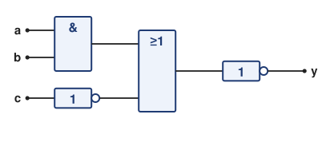
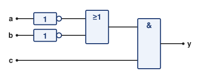
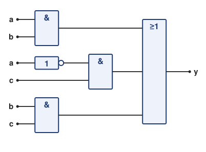
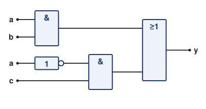

# Lösung Übung 01 – Boolesche Algebra & Grundschaltungen

> **Info 1 · Übung 01** — Aufgabe: [Boolesche Algebra](../Aufgaben/01_Boolesche_Algebra.md) · Lösung: Boolesche Algebra · Hilfsmittel: [Cheatsheet Boolesche Algebra](../Hilfsmittel/01_Cheatsheet_Boolesche_Algebra.md)

---

## Teil 1 – Grundschaltungen (Wahrheitstabellen)

**Schaltung, Schaltzeichen und Timing-Diagramm:** _Noch keine Musterlösung vorhanden._

### a) `y = a ∧ b`
| a | b | y = a∧b |
|:-:|:-:|:-------:|
| 0 | 0 | 0 |
| 0 | 1 | 0 |
| 1 | 0 | 0 |
| 1 | 1 | 1 |

### b) `y = a ∨ b`
| a | b | y = a∨b |
|:-:|:-:|:-------:|
| 0 | 0 | 0 |
| 0 | 1 | 1 |
| 1 | 0 | 1 |
| 1 | 1 | 1 |

### c) `y = ¬a`
| a | y = ¬a |
|:-:|:------:|
| 0 | 1 |
| 1 | 0 |

### d) `y = a ⊕ b = (a∧¬b) ∨ (¬a∧b)`
| a | b | y = a⊕b |
|:-:|:-:|:--------:|
| 0 | 0 | 0 |
| 0 | 1 | 1 |
| 1 | 0 | 1 |
| 1 | 1 | 0 |

### e) `y = ¬(a ∧ b)` (NAND)
| a | b | y = ¬(a∧b) |
|:-:|:-:|:-----------:|
| 0 | 0 | 1 |
| 0 | 1 | 1 |
| 1 | 0 | 1 |
| 1 | 1 | 0 |

### f) `y = ¬(a ∨ b)` (NOR)
| a | b | y = ¬(a∨b) |
|:-:|:-:|:-----------:|
| 0 | 0 | 1 |
| 0 | 1 | 0 |
| 1 | 0 | 0 |
| 1 | 1 | 0 |

---

## Teil 2 – Anwendung der Gesetze

### Aufgabe 2 – Distributivgesetze
a) `a ∧ (b ∨ c) = (a ∧ b) ∨ (a ∧ c)`  
b) `a ∨ (b ∧ c) = (a ∨ b) ∧ (a ∨ c)`

### Aufgabe 3 – De Morgan
a) `¬(a ∧ b) = ¬a ∨ ¬b`  
b) `¬(a ∨ b) = ¬a ∧ ¬b`  
c) `¬(a ∧ (b ∨ c)) = ¬a ∨ ¬(b ∨ c) = ¬a ∨ (¬b ∧ ¬c)`

### Aufgabe 4 – Vereinfachungen (mit Begründung)
a) `(a ∧ b) ∨ (a ∧ ¬b)`  
   → `a ∧ (b ∨ ¬b)` = `a ∧ 1` = **a**  
   *(Distributiv, Komplementär, Neutralität)*  

b) `(a ∨ b) ∧ (a ∨ ¬b)`  
   → `a ∨ (b ∧ ¬b)` = `a ∨ 0` = **a**  
   *(Distributiv, Komplementär, Extremal)*  

c) `(¬a ∨ b) ∧ (a ∨ b)`  
   → `b ∨ (¬a ∧ a)` = `b ∨ 0` = **b**  
   *(Distributiv, Komplementär, Extremal)*  

### Aufgabe 5 – Dualgesetze
- Dual zu `a ∧ 1 = a`  →  `a ∨ 0 = a`  
- Dual zu `a ∧ 0 = 0`  →  `a ∨ 1 = 1`

---

## Teil 3 – Kombinierte Aufgaben

### Aufgabe 6
**Gegeben:** `y = ¬((a ∧ b) ∨ ¬c)`

**1. Schaltung (wie gegeben):**



Von innen nach außen: UND für `a ∧ b`, NICHT für `¬c`, ODER aus beidem, zum Schluss NICHT für die äußere Negation. ODER und NICHT am Ende lassen sich auch zu einem NOR-Gatter zusammenfassen.  
*(Gezeichnet mit DIN-Symbolen wie in Übung 00. Mit den amerikanischen Schaltzeichen ist die Struktur genau dieselbe.)*

**2. und 3. Umformen – Schritt für Schritt:**

| Schritt | Formel | Gesetz |
|:-:|---|---|
| 0 | `y = ¬((a ∧ b) ∨ ¬c)` | gegeben |
| 1 | `y = ¬(a ∧ b) ∧ ¬¬c` | De Morgan auf die große Klammer: `¬` hineinziehen, aus `∨` wird `∧` |
| 2 | `y = (¬a ∨ ¬b) ∧ ¬¬c` | De Morgan auf `¬(a ∧ b)`: `¬` hineinziehen, aus `∧` wird `∨` |
| 3 | `y = (¬a ∨ ¬b) ∧ c` | Doppelnegation `¬¬c = c` |

Nach Schritt 2 steht kein `¬` mehr vor einer Klammer mit `∧` oder `∨` (Teilaufgabe 2). Übrig ist nur noch die doppelte Negation `¬¬c`, die Schritt 3 entfernt (Teilaufgabe 3).

**Endform:** `y = (¬a ∨ ¬b) ∧ c`



> **Auch richtig:** ausmultipliziert (Distributivgesetz) `y = (¬a ∧ c) ∨ (¬b ∧ c)`.

> **Gut zu wissen:** Entfernst du nach Schritt 1 gleich die doppelte Negation, erhältst du `y = ¬(a ∧ b) ∧ c`. Das ist gleichwertig und als Schaltung sogar kleiner (ein NAND- und ein UND-Gatter). Als Ergebnis von Teilaufgabe 2 reicht es aber nicht, weil vor `(a ∧ b)` noch ein `¬` steht: Es fehlt noch ein De-Morgan-Schritt.

> **Typische Fehler:**
> - Zeichen nicht getauscht: `¬((a ∧ b) ∨ ¬c) = ¬(a ∧ b) ∨ c` ist **falsch**. Beim Hineinziehen der Negation wird aus `∨` ein `∧`.
> - `¬(a ∧ b) = ¬a ∧ ¬b` ist **falsch**. Richtig ist `¬a ∨ ¬b`.
> - Doppelte Negation übersehen: `¬¬c` bleibt stehen oder wird fälschlich zu `¬c`.

**4. Kontrolle mit Wahrheitstabelle:**

| a | b | c | a ∧ b | ¬c | (a ∧ b) ∨ ¬c | y = ¬((a ∧ b) ∨ ¬c) | (¬a ∨ ¬b) ∧ c |
|:-:|:-:|:-:|:-:|:-:|:-:|:-:|:-:|
| 0 | 0 | 0 | 0 | 1 | 1 | 0 | 0 |
| 0 | 0 | 1 | 0 | 0 | 0 | **1** | **1** |
| 0 | 1 | 0 | 0 | 1 | 1 | 0 | 0 |
| 0 | 1 | 1 | 0 | 0 | 0 | **1** | **1** |
| 1 | 0 | 0 | 0 | 1 | 1 | 0 | 0 |
| 1 | 0 | 1 | 0 | 0 | 0 | **1** | **1** |
| 1 | 1 | 0 | 1 | 1 | 1 | 0 | 0 |
| 1 | 1 | 1 | 1 | 0 | 1 | 0 | 0 |

Die beiden letzten Spalten sind in jeder Zeile gleich, die Umformung stimmt also.

**5. In Worten:** `y = 1` genau dann, wenn `c = 1` ist **und** `a` und `b` nicht beide 1 sind.

---

### Aufgabe 7
**Gegeben:** `y = (a ∧ ¬b) ∨ (¬a ∧ b)`  
→ **XOR-Funktion**

| a | b | y |
|:-:|:-:|:-:|
| 0 | 0 | 0 |
| 0 | 1 | 1 |
| 1 | 0 | 1 |
| 1 | 1 | 0 |

**Beschreibung:**  
`y = 1` genau dann, wenn `a` und `b` verschieden sind.

---

### Aufgabe 8 – Vollständige Vereinfachung
**Gegeben:** `y = (a ∧ b) ∨ (¬a ∧ c) ∨ (b ∧ c)`

**Kurzfassung:** Der dritte Term `b ∧ c` ist überflüssig (ein sogenannter *Konsensusterm*). Endform: `y = (a ∧ b) ∨ (¬a ∧ c)`.

#### 1. Erst verstehen: Trägt `b ∧ c` überhaupt etwas bei?

| a | b | c | a ∧ b | ¬a ∧ c | b ∧ c | y |
|:-:|:-:|:-:|:-:|:-:|:-:|:-:|
| 0 | 0 | 0 | 0 | 0 | 0 | 0 |
| 0 | 0 | 1 | 0 | 1 | 0 | **1** |
| 0 | 1 | 0 | 0 | 0 | 0 | 0 |
| 0 | 1 | 1 | 0 | 1 | 1 | **1** |
| 1 | 0 | 0 | 0 | 0 | 0 | 0 |
| 1 | 0 | 1 | 0 | 0 | 0 | 0 |
| 1 | 1 | 0 | 1 | 0 | 0 | **1** |
| 1 | 1 | 1 | 1 | 0 | 1 | **1** |

`b ∧ c` ist nur in zwei Zeilen 1 (`a, b, c` = `0, 1, 1` und `1, 1, 1`). In der ersten davon ist aber schon `¬a ∧ c = 1`, in der zweiten schon `a ∧ b = 1`. Es gibt also **keine** Zeile, in der nur `b ∧ c` für die 1 sorgt. Der Term ist überflüssig und darf weg.

**Warum ist das so?** Die Tabelle zeigt, *dass* `b ∧ c` überflüssig ist. Eine Fallunterscheidung nach `a` zeigt, *warum*:

- **`a = 1`:** `y = (1 ∧ b) ∨ (0 ∧ c) ∨ (b ∧ c) = b ∨ 0 ∨ (b ∧ c) = b ∨ (b ∧ c) = b`  
  (Neutralitätsgesetz `1 ∧ b = b`, Extremalgesetz `0 ∧ c = 0`, Neutralitätsgesetz `b ∨ 0 = b`, Absorption)
- **`a = 0`:** `y = (0 ∧ b) ∨ (1 ∧ c) ∨ (b ∧ c) = 0 ∨ c ∨ (b ∧ c) = c ∨ (b ∧ c) = c`  
  (dieselben Gesetze)

In beiden Fällen wird `b ∧ c` „verschluckt“: Wenn `b` und `c` beide 1 sind, ist entweder `a = 1` (dann liefert schon `a ∧ b` die 1) oder `a = 0` (dann liefert schon `¬a ∧ c` die 1).

#### 2. bis 4. Die Rechnung – Schritt für Schritt

**Vorüberlegung: Warum die Absorption nicht sofort klappt.** Das Absorptionsgesetz `p ∨ (p ∧ q) = p` streicht einen langen Term, wenn er einen kurzen Term **vollständig enthält**. Damit `b ∧ c` wegfallen könnte, müsste es also `a ∧ b` oder `¬a ∧ c` enthalten. Es fehlt aber jeweils `a` bzw. `¬a`. Deshalb der Trick: Wir „blasen“ `b ∧ c` so auf, dass `a` und `¬a` darin vorkommen, **ohne seinen Wert zu ändern**.

Damit du in jedem Schritt den Überblick behältst, bekommen die drei Terme Namen:

| Name | Term | Rolle |
|:-:|---|---|
| T1 | `a ∧ b` | bleibt stehen |
| T2 | `¬a ∧ c` | bleibt stehen |
| T3 | `b ∧ c` | soll verschwinden |

Ausgangspunkt:

```
y = (a ∧ b) ∨ (¬a ∧ c) ∨ (b ∧ c)
      T1         T2         T3
```

In den Schritten 1 bis 3 arbeiten wir nur an T3, T1 und T2 schreiben wir einfach mit ab.

##### Schritt 1 – T3 mit 1 UND-verknüpfen (Teilaufgabe 2)

**Was machen wir?** Wir hängen an T3 ein `∧ 1` an: aus `b ∧ c` wird `b ∧ c ∧ 1`.

**Warum dürfen wir das?** Neutralitätsgesetz `p ∧ 1 = p`: Eine UND-Verknüpfung mit 1 ändert nichts, genau wie `· 1` in der normalen Mathematik. Wichtig: Es muss ein **UND** sein. Mit ODER ginge es nicht, denn `p ∨ 1 = 1` (Extremalgesetz) würde den Term zerstören.

```
y = (a ∧ b) ∨ (¬a ∧ c) ∨ (b ∧ c ∧ 1)
```

##### Schritt 2 – Die 1 geschickt ersetzen (Teilaufgabe 2)

**Was machen wir?** Wir ersetzen die 1 durch `(a ∨ ¬a)`.

**Warum dürfen wir das?** Komplementärgesetz `a ∨ ¬a = 1`: `a` ist entweder 1 oder 0. „`a` oder nicht `a`“ ist deshalb immer erfüllt, also immer 1. Der Wert von T3 ändert sich nicht, aber jetzt stecken `a` und `¬a` in T3. Genau das hat für die Absorption gefehlt.

```
y = (a ∧ b) ∨ (¬a ∧ c) ∨ (b ∧ c ∧ (a ∨ ¬a))
```

##### Schritt 3 – Ausmultiplizieren (Teilaufgabe 3)

**Was machen wir?** Wir lösen die Klammer `(a ∨ ¬a)` auf, indem wir `b ∧ c` mit jedem der beiden Teile der Klammer verknüpfen. Dadurch zerfällt T3 in zwei Terme:

```
b ∧ c ∧ (a ∨ ¬a)  =  (b ∧ c ∧ a) ∨ (b ∧ c ∧ ¬a)
```

**Warum dürfen wir das?** Distributivgesetz `p ∧ (q ∨ r) = (p ∧ q) ∨ (p ∧ r)`, hier mit `p = b ∧ c`, `q = a` und `r = ¬a`. Das ist dasselbe wie das Ausmultiplizieren `x · (y + z) = x · y + x · z` aus der Schule.

Eingesetzt haben wir jetzt vier Terme:

```
y = (a ∧ b) ∨ (¬a ∧ c) ∨ (b ∧ c ∧ a) ∨ (b ∧ c ∧ ¬a)
```

##### Schritt 4 – In den neuen Termen umsortieren (Teilaufgabe 4)

**Was machen wir?** In den zwei neuen Termen ordnen wir die Variablen so, dass man T1 bzw. T2 vorne wiedererkennt:

- `b ∧ c ∧ a` wird zu `a ∧ b ∧ c`: vorne steht jetzt T1 = `a ∧ b`
- `b ∧ c ∧ ¬a` wird zu `¬a ∧ c ∧ b`: vorne steht jetzt T2 = `¬a ∧ c`

**Warum dürfen wir das?** Kommutativgesetz `p ∧ q = q ∧ p` und Assoziativgesetz: Bei UND sind Reihenfolge und Klammerung egal.

```
y = (a ∧ b) ∨ (¬a ∧ c) ∨ (a ∧ b ∧ c) ∨ (¬a ∧ c ∧ b)
```

##### Schritt 5 – Passende Terme nebeneinanderstellen (Teilaufgabe 4)

**Was machen wir?** Wir stellen jeden langen Term direkt neben den kurzen Term, den er enthält, und fassen die beiden Paare mit Klammern zusammen:

- Paar 1: `(a ∧ b) ∨ (a ∧ b ∧ c)`
- Paar 2: `(¬a ∧ c) ∨ (¬a ∧ c ∧ b)`

**Warum dürfen wir das?** Kommutativ- und Assoziativgesetz für ODER: Auch bei `∨` sind Reihenfolge und Klammerung egal.

```
y = ((a ∧ b) ∨ (a ∧ b ∧ c)) ∨ ((¬a ∧ c) ∨ (¬a ∧ c ∧ b))
```

##### Schritt 6 – Absorption auf Paar 1 (Teilaufgabe 4)

```
(a ∧ b) ∨ (a ∧ b ∧ c)  =  a ∧ b
```

**Warum dürfen wir das?** Absorptionsgesetz `p ∨ (p ∧ q) = p` mit `p = a ∧ b` und `q = c`. Anschaulich: Immer wenn der lange Term `a ∧ b ∧ c` gleich 1 ist, ist der kurze Term `a ∧ b` sowieso schon 1. Der lange Term bringt nichts Neues und wird „verschluckt“.

##### Schritt 7 – Absorption auf Paar 2 (Teilaufgabe 4)

```
(¬a ∧ c) ∨ (¬a ∧ c ∧ b)  =  ¬a ∧ c
```

**Warum dürfen wir das?** Dasselbe Gesetz, diesmal mit `p = ¬a ∧ c` und `q = b`.

##### Ergebnis

```
y = (a ∧ b) ∨ (¬a ∧ c)
```

T3 ist komplett verschwunden. Wir haben ihn zuerst aufgeblasen (Schritte 1 bis 3), damit er in zwei Teile zerfällt. Jeder Teil wurde dann von T1 bzw. T2 verschluckt (Schritte 6 und 7).

**Alles auf einen Blick** (z. B. für die Tafel):

| Schritt | Teilaufgabe | Umformung | Gesetz |
|:-:|:-:|---|---|
| 0 | – | `y = (a ∧ b) ∨ (¬a ∧ c) ∨ (b ∧ c)` | gegeben |
| 1 | 2 | `y = (a ∧ b) ∨ (¬a ∧ c) ∨ (b ∧ c ∧ 1)` | Neutralitätsgesetz `p ∧ 1 = p` |
| 2 | 2 | `y = (a ∧ b) ∨ (¬a ∧ c) ∨ (b ∧ c ∧ (a ∨ ¬a))` | Komplementärgesetz `a ∨ ¬a = 1` |
| 3 | 3 | `y = (a ∧ b) ∨ (¬a ∧ c) ∨ (b ∧ c ∧ a) ∨ (b ∧ c ∧ ¬a)` | Distributivgesetz mit `p = b ∧ c` |
| 4 | 4 | `y = (a ∧ b) ∨ (¬a ∧ c) ∨ (a ∧ b ∧ c) ∨ (¬a ∧ c ∧ b)` | Kommutativgesetz (bei `∧`) |
| 5 | 4 | `y = ((a ∧ b) ∨ (a ∧ b ∧ c)) ∨ ((¬a ∧ c) ∨ (¬a ∧ c ∧ b))` | Kommutativ- und Assoziativgesetz (bei `∨`) |
| 6–7 | 4 | `y = (a ∧ b) ∨ (¬a ∧ c)` | Absorption `p ∨ (p ∧ q) = p`, zweimal |

#### 5. Endformel und Gattervergleich

**Endform:** `y = (a ∧ b) ∨ (¬a ∧ c)`

**Probe:** Gegebene Formel und Endform müssen für alle Eingänge dasselbe liefern:

| a | b | c | (a ∧ b) ∨ (¬a ∧ c) ∨ (b ∧ c) | (a ∧ b) ∨ (¬a ∧ c) |
|:-:|:-:|:-:|:-:|:-:|
| 0 | 0 | 0 | 0 | 0 |
| 0 | 0 | 1 | **1** | **1** |
| 0 | 1 | 0 | 0 | 0 |
| 0 | 1 | 1 | **1** | **1** |
| 1 | 0 | 0 | 0 | 0 |
| 1 | 0 | 1 | 0 | 0 |
| 1 | 1 | 0 | **1** | **1** |
| 1 | 1 | 1 | **1** | **1** |

Beide Spalten sind in jeder Zeile gleich, die Vereinfachung stimmt also.

**Vorher:** 3 UND + 1 ODER + 1 NICHT = **5 Gatter**



**Nachher:** 2 UND + 1 ODER + 1 NICHT = **4 Gatter**, also 1 Gatter gespart.



*(Eingänge, die mehrfach gebraucht werden, sind der Übersicht halber mehrfach eingezeichnet. In der echten Schaltung ist es jeweils dieselbe Leitung.)*

Wer nur Gatter mit zwei Eingängen verwendet, braucht vorher zwei ODER (6 Gatter) und spart damit 2. Beide Zählweisen sind richtig. Wichtig ist die Erkenntnis: Weniger Gatter bedeuten weniger Bauteile, weniger Stromverbrauch und weniger Platz auf der Platine, bei genau derselben Funktion.

#### 6. Was macht die Schaltung? Ein Multiplexer

Aus der Fallunterscheidung in Teilaufgabe 1 folgt:

| a | y |
|:-:|:-:|
| 0 | c |
| 1 | b |

**Erwartete Antwort:** Ist `a = 1`, kommt `b` am Ausgang an, sonst `c`. Den Begriff „Multiplexer“ musst du dafür nicht kennen.

`a` ist also ein **Umschalter**: Er entscheidet, ob `b` oder `c` zum Ausgang durchgereicht wird. So eine Schaltung heißt **2-zu-1-Multiplexer**. In C++ würde man schreiben:

```cpp
y = a ? b : c;   // gleichbedeutend mit: if (a) y = b; else y = c;
```

Multiplexer stecken z. B. in jedem Mikrocontroller: Über ein Konfigurationsbit wird festgelegt, welches von zwei Signalen an einem Pin ankommt.

#### Merke: Konsensusregel

```
(p ∧ q) ∨ (¬p ∧ r) ∨ (q ∧ r) = (p ∧ q) ∨ (¬p ∧ r)
```

**So erkennst du sie:** Eine Variable kommt in zwei Termen einmal normal und einmal negiert vor (hier `a` und `¬a`). Der dritte Term besteht genau aus den übrigen Variablen dieser beiden Terme (hier `b` und `c`). Dieser dritte Term, der *Konsensusterm*, ist überflüssig und darf gestrichen werden.

> **Typischer Fehler:** den falschen Term streichen. `a ∧ b` und `¬a ∧ c` dürfen **nicht** weg, nur der Konsensusterm `b ∧ c`. Im Zweifel mit der Wahrheitstabelle prüfen.

---

## Teil 4 – Wahrheitstabellen & Timing (verbale Beschreibung)

- **AND:** y = 1 nur wenn a = 1 und b = 1 gleichzeitig.  
- **OR:** y = 1, sobald mindestens einer der Eingänge 1 ist.  
- **NOT:** y ist das Inverse von a.  
- **XOR:** y = 1, wenn a und b verschieden sind.  
- **NAND:** Invertiertes AND.  
- **NOR:** Invertiertes OR.

---

## Teil 5 – Reflexion

1. **Welche Gesetze erlauben das Herausziehen und Hineinziehen von Negationen?**  
   → *De Morgan-Gesetze.*

2. **Welche Gesetze sind für Vereinfachungen in Schaltplänen am wichtigsten?**  
   → *Distributiv-, Absorptions-, Komplementär- und De Morgan-Gesetze.*

3. **Warum sind NAND- und NOR-Gatter in der Hardwareentwicklung so wichtig?**  
   → *Sie sind universell einsetzbar (funktional vollständig) und benötigen weniger Transistoren.*
