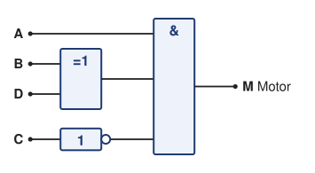
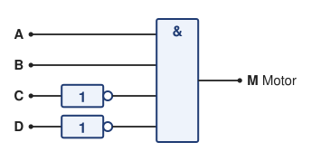

# Lösung Übung 02 – Recap Übung 01: Von Boolescher Logik zur Programmierung

> **Info 1 · Übung 02** — Aufgaben: [Zahlen und Datentypen](../Aufgaben/02_Zahlen_und_Datentypen.md), [Recap Logik zur Programmierung](../Aufgaben/02_Recap_Logik_zur_Programmierung.md) · Lösungen: [Zahlen und Datentypen](../Lösungen/02_Zahlen_und_Datentypen_Lösung.md), Recap Logik zur Programmierung · Hilfsmittel: [Cheatsheet Register und Datentypen](../Hilfsmittel/02_Cheatsheet_Register_und_Datentypen.md)

---

## 1. Kurzer Recap der wichtigsten Gesetze

| Kategorie | Beispiel | Bedeutung |
|------------|-----------|------------|
| **Kommutativgesetz** | `a∧b = b∧a` | Reihenfolge egal |
| **Assoziativgesetz** | `(a∨b)∨c = a∨(b∨c)` | Klammern verschiebbar |
| **Distributivgesetz** | `a∧(b∨c) = (a∧b)∨(a∧c)` | „Ausmultiplizieren“ |
| **De Morgan** | `¬(a∧b) = ¬a∨¬b` | Negation verteilt sich |
| **Neutralität / Extremal** | `a∧1=a`, `a∨0=a`, `a∧0=0`, `a∨1=1` | 0/1 verhalten sich wie Multiplikation/Addition |
| **Komplementär** | `a∧¬a=0`, `a∨¬a=1` | Gegensatz hebt sich auf |
| **Absorption** | `a∨(a∧b)=a` | Überflüssige Teile verschwinden |
| **Idempotenz** | `a∧a=a`, `a∨a=a` | Wiederholung ändert nichts |

Alle Gesetze ausführlich: [Cheatsheet Boolesche Algebra](../Hilfsmittel/01_Cheatsheet_Boolesche_Algebra.md)

---

## 2. Aufgabenstellung

### Ausgangssituation (Textform)

> In unserer Steuerung soll der **Motor** nur eingeschaltet werden, wenn folgende Bedingung erfüllt ist:  
>
> - **Nur wenn A und B bei 1 sind, aber nicht C.**  
> - Wenn **D und A und B**, dann **geht er *nicht* an**.  
> - Wenn **nur D und A**, dann **geht er an**.
>
> *Hinweis: „nur D und A“ heißt: D und A sind 1, alle anderen Eingänge (B und C) sind 0.*

### Ziel

1. Schreibe die **Boolesche Funktion** aus dem Text.  
2. Erstelle eine **Wahrheitstabelle**.  
3. **Vereinfache** den Ausdruck mit den Gesetzen.  
4. Übersetze das Ergebnis in **eine einfache if-else-Struktur**.

---

## 3. Lösung Schritt für Schritt

### a) Boolescher Ausdruck (direkt aus dem Text)

Wir übersetzen jede Regel einzeln und setzen sie danach zusammen.

| Regel im Text | Bedeutung | Term |
|---|---|---|
| 1. „Nur wenn A und B bei 1 sind, aber nicht C.“ | Grundregel: Motor an | `A ∧ B ∧ ¬C` |
| 2. „Wenn D und A und B, dann geht er nicht an.“ | Ausnahme von Regel 1: Motor aus | `¬(D ∧ A ∧ B)` |
| 3. „Wenn nur D und A, dann geht er an.“ | zweiter Weg zum Motor an. „Nur“ heißt: alle anderen Eingänge sind 0, also `B = 0` und `C = 0` | `D ∧ A ∧ ¬B ∧ ¬C` |

Regel 1 und Regel 3 beschreiben, wann der Motor **angeht**. Das sind zwei unabhängige Wege, deshalb werden sie mit ODER verknüpft. (Das „Nur wenn“ in Regel 1 ist dabei nicht als „ausschließlich dann“ gemeint, sonst dürfte Regel 3 den Motor mit `B = 0` gar nicht einschalten.)

Regel 2 beschreibt dagegen, wann der Motor **aus** bleiben muss. Für `M` brauchen wir das Gegenteil, nämlich „Regel 2 trifft nicht zu“. Deshalb steht ihr Term negiert da und wird mit UND angehängt. Eigentlich gilt dieses Verbot für beide Wege. Regel 3 kann aber nie darunter fallen, weil dort `B = 0` ist. Deshalb reicht es, Regel 2 an Regel 1 zu hängen:

```text
M = ((A ∧ B ∧ ¬C) ∧ ¬(D ∧ A ∧ B)) ∨ (D ∧ A ∧ ¬B ∧ ¬C)
```

> **Auch richtig:** Du kannst Regel 2 auch auf beide Wege anwenden: `M = ((A ∧ B ∧ ¬C) ∨ (D ∧ A ∧ ¬B ∧ ¬C)) ∧ ¬(D ∧ A ∧ B)` ergibt dieselbe Wahrheitstabelle.

> **Achtung, Klammern!** Lässt du in dieser Variante die Klammer um die beiden „an“-Regeln weg, also `(A ∧ B ∧ ¬C) ∨ (D ∧ A ∧ ¬B ∧ ¬C) ∧ ¬(D ∧ A ∧ B)`, wirkt die Ausnahme aus Regel 2 nur noch auf Regel 3, denn UND bindet stärker als ODER. Dann liefe der Motor bei `A = B = D = 1`, `C = 0` an, obwohl Regel 2 genau das verbietet.

> **Andere Lesart (Hinweis zur Bewertung):** Wer „nur D und A“ so versteht, dass C keine Rolle spielt, schreibt für Regel 3 `D ∧ A ∧ ¬B`. Das ist sprachlich vertretbar und ergibt `M = (A ∧ B ∧ ¬C ∧ ¬D) ∨ (A ∧ ¬B ∧ D)`. Der Unterschied liegt nur in der Zeile `A, B, C, D = 1, 0, 1, 1`. Die Musterlösung verwendet die strenge Lesart („nur“ = alle anderen sind 0), so wie es auch der Hinweis in der Aufgabe festlegt. Bei der anderen Lesart führt die Vereinfachung aus c) auf `A ∧ (B ⊕ D) ∧ ¬(B ∧ C)`, im Code kommt dann `!(B && C)` statt `!C` dazu. Die Bonusfrage ergibt bei beiden Lesarten dasselbe.

---

### b) Wahrheitstabelle

Mit 4 Eingängen gibt es 2⁴ = **16** Zeilen:

| A | B | C | D | M | Welche Regel greift? |
|:-:|:-:|:-:|:-:|:-:|---|
| 0 | 0 | 0 | 0 | 0 | A = 0: keine Regel erfüllt |
| 0 | 0 | 0 | 1 | 0 | A = 0: keine Regel erfüllt |
| 0 | 0 | 1 | 0 | 0 | A = 0: keine Regel erfüllt |
| 0 | 0 | 1 | 1 | 0 | A = 0: keine Regel erfüllt |
| 0 | 1 | 0 | 0 | 0 | A = 0: keine Regel erfüllt |
| 0 | 1 | 0 | 1 | 0 | A = 0: keine Regel erfüllt |
| 0 | 1 | 1 | 0 | 0 | A = 0: keine Regel erfüllt |
| 0 | 1 | 1 | 1 | 0 | A = 0: keine Regel erfüllt |
| 1 | 0 | 0 | 0 | 0 | weder B (Regel 1) noch D (Regel 3) |
| 1 | 0 | 0 | 1 | **1** | Regel 3: nur D und A → an |
| 1 | 0 | 1 | 0 | 0 | keine Regel erfüllt |
| 1 | 0 | 1 | 1 | 0 | C = 1: nicht „nur“ D und A, Regel 3 greift nicht |
| 1 | 1 | 0 | 0 | **1** | Regel 1: A und B, nicht C → an |
| 1 | 1 | 0 | 1 | 0 | Regel 2: D und A und B → aus |
| 1 | 1 | 1 | 0 | 0 | C = 1: Regel 1 greift nicht |
| 1 | 1 | 1 | 1 | 0 | C = 1 und Regel 2 → aus |

Der Motor läuft also nur in **zwei** Fällen: `A, B, C, D = 1, 0, 0, 1` und `1, 1, 0, 0`.

---

### c) Vereinfachung

#### Weg 1: Mit den Gesetzen

| Schritt | Umformung | Gesetz |
|:-:|---|---|
| 0 | `M = ((A ∧ B ∧ ¬C) ∧ ¬(A ∧ B ∧ D)) ∨ (A ∧ ¬B ∧ ¬C ∧ D)` | aus a), Variablen sortiert (Kommutativgesetz) |
| 1 | `M = ((A ∧ B ∧ ¬C) ∧ (¬A ∨ ¬B ∨ ¬D)) ∨ (A ∧ ¬B ∧ ¬C ∧ D)` | De Morgan |
| 2 | `M = (A ∧ B ∧ ¬C ∧ ¬A) ∨ (A ∧ B ∧ ¬C ∧ ¬B) ∨ (A ∧ B ∧ ¬C ∧ ¬D) ∨ (A ∧ ¬B ∧ ¬C ∧ D)` | Distributivgesetz (ausmultiplizieren) |
| 3 | `M = 0 ∨ 0 ∨ (A ∧ B ∧ ¬C ∧ ¬D) ∨ (A ∧ ¬B ∧ ¬C ∧ D)` | Kommutativgesetz (umsortieren, z. B. `A ∧ ¬A ∧ B ∧ ¬C`), dann Komplementärgesetz `A ∧ ¬A = 0` bzw. `B ∧ ¬B = 0`, dann Extremalgesetz `p ∧ 0 = 0` |
| 4 | `M = (A ∧ B ∧ ¬C ∧ ¬D) ∨ (A ∧ ¬B ∧ ¬C ∧ D)` | Neutralitätsgesetz `0 ∨ p = p` |
| 5 | `M = (A ∧ ¬C) ∧ ((B ∧ ¬D) ∨ (¬B ∧ D))` | Kommutativgesetz (`A ∧ ¬C` in beiden Termen nach vorne), dann Distributivgesetz rückwärts: `A ∧ ¬C` ausklammern |
| 6 | `M = A ∧ ¬C ∧ (B ⊕ D)` | XOR: `(B ∧ ¬D) ∨ (¬B ∧ D) = B ⊕ D` (siehe [Übung 01, Aufgabe 7](../Lösungen/01_Boolesche_Algebra_Lösung.md#aufgabe-7)) |

**Was passiert in den einzelnen Schritten?**

- **Schritt 1:** Die Ausnahme `¬(A ∧ B ∧ D)` wird mit De Morgan aufgelöst: „nicht alle drei“ heißt „mindestens einer ist 0“.
- **Schritt 2:** `A ∧ B ∧ ¬C` wird mit jedem der drei Teile `¬A`, `¬B`, `¬D` verknüpft. Aus einem Term werden drei.
- **Schritt 3 und 4:** Zwei der drei neuen Terme enthalten einen Widerspruch (`A` und `¬A` bzw. `B` und `¬B`). Sie sind immer 0 und fallen weg.
- **Schritt 5:** Beide übrigen Terme enthalten `A ∧ ¬C`. Das ziehen wir nach vorne, wie beim Ausklammern `x·y + x·z = x·(y + z)`.
- **Schritt 6:** In der Klammer steht „B, aber nicht D“ oder „D, aber nicht B“, also „genau einer von beiden“. Das ist XOR.

#### Weg 2: Direkt aus der Wahrheitstabelle

Der Motor ist nur in zwei Zeilen an. Für jede dieser Zeilen schreibt man einen UND-Term, in dem jede Variable vorkommt (1 → Variable, 0 → negierte Variable), und verknüpft die Terme mit ODER:

- Zeile `1, 0, 0, 1` → `A ∧ ¬B ∧ ¬C ∧ D`
- Zeile `1, 1, 0, 0` → `A ∧ B ∧ ¬C ∧ ¬D`

**Warum klappt das?** Jeder dieser UND-Terme ist nur in genau seiner Zeile 1, in allen anderen Zeilen ist mindestens ein Teil 0. Mit ODER verknüpft ist der Ausdruck also genau in den beiden Zeilen 1, in denen der Motor läuft.

Das ergibt direkt Schritt 4 von Weg 1 (nur die Reihenfolge der Terme ist vertauscht, Kommutativgesetz). Ab da geht es mit Ausklammern und XOR weiter wie oben.

#### Ergebnis

```text
M = A ∧ ¬C ∧ (B ⊕ D)
```

> Erklärung:
> - `B ⊕ D` (XOR) bedeutet: genau einer von beiden ist 1.
> - Also: Motor an, wenn A aktiv ist, C nicht aktiv ist, und **entweder B oder D**, aber nicht beide.



*(Der Baustein `=1` ist das XOR nach DIN: Der Ausgang ist 1, wenn genau ein Eingang 1 ist.)*

---

### d) Übertragung in Programm-Logik

```cpp
bool A, B, C, D;   // Eingänge, nur 0 oder 1
bool motor;

if (A && !C && (B ^ D)) {
    motor = true;    // Motor EIN
} else {
    motor = false;   // Motor AUS
}
```

`^` ist in C++ das **bitweise** XOR (kennst du aus [Zahlen und Datentypen](../Aufgaben/02_Zahlen_und_Datentypen.md)). Ein logisches XOR wie `&&` oder `||` gibt es in C++ nicht. Hier funktioniert `^` trotzdem, weil `A` bis `D` vom Typ `bool` sind und nur 0 oder 1 sein können. Lesbarer ist `B != D`: „B und D sind verschieden“.

> **Achtung bei echten Pins:** Liest du einen Eingang als Bitmaske ein, z. B. ergibt `PINB & (1 << 2)` den Wert 0 oder 4, liefern `^` und `!=` falsche Ergebnisse: `4 ^ 1 = 5`, also „wahr“, obwohl beide Eingänge an sind. Wandle den Wert vorher in `bool` um: `bool B = PINB & (1 << 2);`

Ohne XOR geht es auch mit verschachtelten `if`-Abfragen. Das entspricht Schritt 5 aus c): außen `A ∧ ¬C`, innen die beiden Fälle „B, aber nicht D“ und „D, aber nicht B“:

```cpp
bool motor = false;
if (A && !C) {
    if (B && !D) {
        motor = true;    // Regel 1, aber nur bei D = 0 (sonst greift Regel 2)
    } else if (!B && D) {
        motor = true;    // Regel 3: nur D und A
    }
}
```

Beide Varianten verhalten sich gleich.

---

## 4. Bonusfrage

Wie würde sich die Schaltung verändern, wenn „D“ ein **Not-Aus-Schalter** wäre, also der Motor **nie an** ist, wenn D = 1, egal was A, B oder C machen?

> Tipp: Überlege, wie du „D“ als zusätzliche Negation in die Formel einbauen würdest.

### Lösung

**Idee:** Der Not-Aus muss alles andere überstimmen. Das erreicht man, indem man die ganze bisherige Funktion mit `¬D` UND-verknüpft:

- Ist `D = 1`, dann ist `¬D = 0` und damit `M = 0`, egal was der Rest ergibt (Extremalgesetz `0 ∧ p = 0`).
- Ist `D = 0`, dann ist `¬D = 1` und `M_neu = M_alt` (Neutralitätsgesetz `1 ∧ p = p`): Ohne Not-Aus bleibt alles wie vorher.

Mit ODER ginge das nicht: Dann liefe der Motor bei jedem `D = 0`.

```text
M_neu = ¬D ∧ M_alt = ¬D ∧ A ∧ ¬C ∧ (B ⊕ D)
```

**Vereinfachen:** Wenn `D = 0` sein muss, wird aus `B ⊕ D` einfach `B ⊕ 0 = B`. Schritt für Schritt:

| Schritt | Umformung | Gesetz |
|:-:|---|---|
| 0 | `M_neu = A ∧ ¬C ∧ ¬D ∧ ((B ∧ ¬D) ∨ (¬B ∧ D))` | XOR ausgeschrieben, `¬D` nach hinten sortiert |
| 1 | `M_neu = A ∧ ¬C ∧ ((¬D ∧ B ∧ ¬D) ∨ (¬D ∧ ¬B ∧ D))` | Distributivgesetz: `¬D` in die Klammer |
| 2 | `M_neu = A ∧ ¬C ∧ ((B ∧ ¬D) ∨ 0)` | Kommutativgesetz (umsortieren), Idempotenzgesetz `¬D ∧ ¬D = ¬D`; Komplementärgesetz `¬D ∧ D = 0`, dann Extremalgesetz `p ∧ 0 = 0` |
| 3 | `M_neu = A ∧ B ∧ ¬C ∧ ¬D` | Neutralitätsgesetz `p ∨ 0 = p`, sortiert |

```text
M_neu = A ∧ B ∧ ¬C ∧ ¬D
```

**Was ändert sich?**

- Regel 3 („nur D und A → an“) fällt komplett weg. Sie widerspricht dem Not-Aus: `D = 1` darf den Motor nie einschalten.
- Regel 2 („D und A und B → aus“) wird überflüssig, weil der Not-Aus bei `D = 1` ohnehin alles abschaltet.
- Übrig bleibt nur Regel 1, ergänzt um die Bedingung „kein Not-Aus“. Der Motor läuft nur noch bei `A, B, C, D = 1, 1, 0, 0`.
- In der Schaltung verschwindet der XOR-Baustein. Stattdessen kommt `D` negiert als zusätzlicher Eingang an das UND:

| vorher | nachher (mit Not-Aus) |
|:-:|:-:|
|  |  |

**Im Programm** fragt man den Not-Aus zuerst ab, damit er Vorrang vor allem anderen hat:

```cpp
if (D) {
    motor = false;          // Not-Aus hat immer Vorrang
} else if (A && B && !C) {
    motor = true;           // Motor EIN
} else {
    motor = false;          // Motor AUS
}
```

> **Aus der Praxis:** Ein echter Not-Aus wird nicht nur im Programm abgefragt. Er schaltet die Energie zum Motor zusätzlich direkt in der Hardware ab (als Öffner-Kontakt, der bei Betätigung oder Kabelbruch den Stromkreis unterbricht). So bleibt der Motor auch dann aus, wenn die Software abstürzt. Deshalb ist das Not-Aus-Signal in echten Anlagen meist *low-aktiv*: 1 heißt „alles in Ordnung“, 0 heißt „gedrückt oder Kabel ab“. In der Formel stünde dann `D` statt `¬D`.
