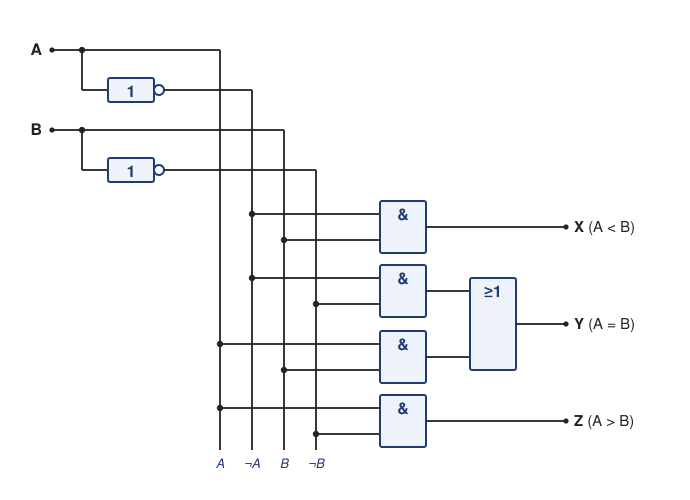

# Lösung Übung 03 – 1-Bit-Komparator, Flipflops und Datentypen

> **Info 1 · Übung 03** — Aufgabe: [Komparator, Flipflops und Datentypen](../Aufgaben/03_Komparator_Flipflops_Datentypen.md) · Lösung: Komparator, Flipflops und Datentypen

---

## Teil A: 1-Bit-Komparator

**Wahrheitstabelle:**

| A | B | X (=A<B) | Y (=A=B) | Z (=A>B) |
|---|---|-----------|-----------|-----------|
| 0 | 0 | 0 | 1 | 0 |
| 0 | 1 | 1 | 0 | 0 |
| 1 | 0 | 0 | 0 | 1 |
| 1 | 1 | 0 | 1 | 0 |

**Logische Gleichungen:**
- `X = ¬A ∧ B`  
- `Y = (¬A ∧ ¬B) ∨ (A ∧ B)`  
- `Z = A ∧ ¬B`

**So kommt man darauf:** Man liest in der Tabelle ab, in welchen Zeilen der Ausgang 1 ist, und schreibt für jede dieser Zeilen einen UND-Term (Eingang 1 → Variable, Eingang 0 → negierte Variable):

- `X` ist nur in der Zeile `A = 0, B = 1` gleich 1 → `¬A ∧ B`
- `Z` ist nur in der Zeile `A = 1, B = 0` gleich 1 → `A ∧ ¬B`
- `Y` ist in zwei Zeilen 1 (`0, 0` und `1, 1`) → die beiden Terme mit ODER verknüpfen: `(¬A ∧ ¬B) ∨ (A ∧ B)`

Weiter vereinfachen lassen sich die Gleichungen mit NICHT, UND und ODER nicht mehr.

**Logisches Schaltbild:**

**So liest du das Schaltbild:**

- Links kommen die Eingänge `A` und `B` herein. Je ein NICHT-Gatter erzeugt daraus `¬A` und `¬B`.
- Die vier senkrechten Leitungen führen `A`, `¬A`, `B` und `¬B` nach unten (Beschriftung am unteren Ende). Ein Punkt markiert, wo ein Gatter eine Leitung abgreift. Kreuzen sich Leitungen **ohne** Punkt, sind sie nicht verbunden.
- **X:** UND aus `¬A` und `B`
- **Y:** zwei UND-Gatter (`¬A ∧ ¬B` und `A ∧ B`), deren Ausgänge ein ODER zusammenführt
- **Z:** UND aus `A` und `¬B`

Insgesamt braucht die Schaltung **7 Gatter**: 2 NICHT, 4 UND und 1 ODER.

*(Gezeichnet mit DIN-Symbolen wie in Übung 00 und 01. Mit den amerikanischen Schaltzeichen ist die Struktur genau dieselbe.)*

> **Gut zu wissen:** `Y` ist genau dann 1, wenn weder `X` noch `Z` 1 ist (die Zahlen sind entweder gleich, kleiner oder größer). Deshalb gilt auch `Y = ¬(X ∨ Z)`. Weil `Y` dann die schon vorhandenen Ausgänge `X` und `Z` wiederverwendet, fallen die beiden UND-Gatter für `Y` weg. Dafür kommt ein NICHT-Gatter hinter das ODER, insgesamt also 6 statt 7 Gatter.

---

## Teil B: Flipflops (Kurzüberblick)

| Nr. | Flipflop-Typ | Besonderheit / Beschreibung |
|-----|---------------|-----------------------------|
| 1 | RS-FF | Grund-Speicherelement mit Set/Reset, asynchron. |
| 2 | RS-FF mit S-dominierendem Eingang | Set = 1 dominiert → kein undefinierter Zustand. |
| 3 | D-FF (taktzustandsgesteuert) | Übernimmt D bei aktivem Takt, 1 Bit Speicher. |
| 4 | JK-FF (taktzustandsgesteuert) | Universell, toggelt bei J = K = 1. |
| 5 | JK-MS-FF (taktzustandsgesteuert) | Zweistufig → Flankensteuerung. |
| 6 | Flankengesteuerte FF | Reaktion nur auf Taktflanke → störsicher. |
| 7 | T-FF (flankengesteuert) | Toggle bei jeder Flanke, wenn T = 1. |

---

## Teil C: Datentypen

| Nr. | Datentyp  | Speicher (Byte) | Wertebereich | Vorzeichen |
|-----|-----------|-----------------|---------------|-------------|
| 1 | `uint8_t` | 1 | 0 – 255 | nein |
| 2 | `int16_t` | 2 | −32 768 – +32 767 | ja |
| 3 | `float` | 4 | ±3.4028235×10³⁸ (~6–7 Dezimalstellen) | ja |

---

### Bonus – Overflow

`1111 1111₂ = 255₁₀`, nach `+1` → `0000 0000₂`, da `(255 + 1) mod 256 = 0`.  
→ **Überlauf (Wrap-around)** im 8-Bit-Bereich.
